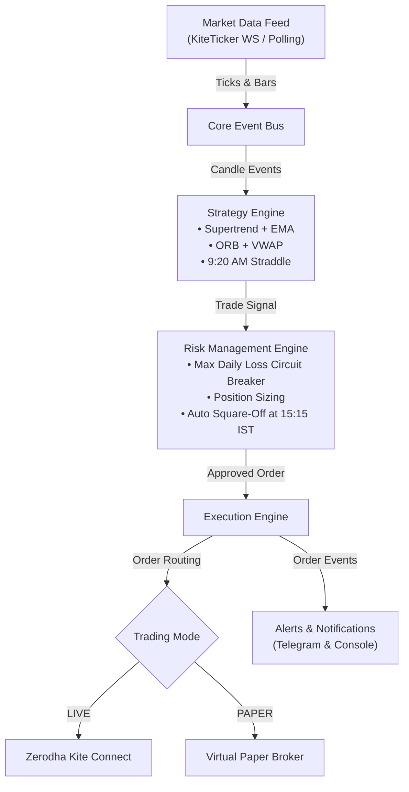

# Zerodha Algo Trader (India Equities & F&O)

A production-grade, modular algorithmic trading platform built specifically for Indian financial markets (NSE, NFO, BSE) using **Zerodha Kite Connect v3**.

Featuring high-speed event-driven execution, multi-layer risk controls (SEBI-aligned), automated TOTP authentication, dual-mode execution (Live Broker vs. High-Fidelity Paper Trading), and built-in strategies for Intraday Equities and Index Options.

---

## Architecture Overview



---

## Key Features

1. **Dual Execution Modes**:
   - `TRADING_MODE=PAPER`: Trades real live market quotes and ticks in a simulated environment with realistic slippage and PnL tracking (zero capital risk).
   - `TRADING_MODE=LIVE`: Direct routing to Zerodha Kite Connect API with order verification.

2. **SEBI-Compliant Risk Management**:
   - **Daily Max Loss Circuit Breaker**: Emergency liquidation and halt if loss reaches configured limit (e.g. ₹5,000).
   - **Max Trades Per Day Limit**: Prevents overtrading and exchange penalty fees.
   - **Position Sizing Calculator**: Dynamically adjusts lot size based on per-trade risk tolerance.
   - **Mandatory 15:15 IST Auto Square-Off**: Closes all MIS intraday positions automatically before Zerodha charges auto-square-off penalty fees.
   - **Instant Kill Switch**: Emergency command to immediately cancel all open orders and square off all open positions.

3. **Built-in Strategies**:
   - **`Supertrend + EMA`**: 5-minute / 15-minute trend-following strategy combining Supertrend (10, 3) with a 20 EMA filter for Nifty, BankNifty, and high-momentum stocks.
   - **`ORB + VWAP`**: Opening Range Breakout strategy tracking the first 15-minute range (9:15 to 9:30 AM IST) with VWAP volume confirmation.
   - **`9:20 AM Short Straddle`**: High-probability index options intraday strategy selling ATM Call & Put with 25% stop-loss per leg.

4. **Zero-Touch Automated Authentication**:
   - Automated headless login using Zerodha User ID, Password, and TOTP key (via `pyotp`).
   - Daily access token cache (`storage/access_token.json`) valid until 6:00 AM IST next morning.
   - Manual OAuth redirect token generation fallback if automated login is not configured.

5. **Telegram Bot Alerts**:
   - Immediate push notifications on trade triggers, target hits, stop-loss exits, and circuit breaker events.

---

## Project Structure

```
zerodha_algo_trader/
├── config/
│   ├── settings.py           # Environment variables & configuration
│   └── market_hours.py       # NSE/BSE session & square-off calendar
├── core/
│   ├── compat.py             # Windows socket compatibility patch
│   ├── models.py             # Dataclasses (Candle, Tick, Signal, Order, Position)
│   ├── events.py             # Decoupled synchronous EventBus
│   └── exceptions.py         # Custom domain exceptions
├── broker/
│   ├── base.py               # Abstract BaseBroker interface
│   ├── zerodha_broker.py     # Production Zerodha Kite Connect client
│   └── paper_broker.py       # High-fidelity paper trading engine
├── data/
│   ├── feed.py               # KiteTicker WS client & Candle Aggregator
│   └── instruments.py        # Zerodha instruments master downloader & search
├── risk/
│   └── risk_manager.py       # Position sizing, limits & circuit breaker
├── strategies/
│   ├── base_strategy.py      # Abstract strategy base class
│   ├── indicators.py         # Vectorized Supertrend, EMA, VWAP, ATR, CPR
│   ├── supertrend_ema.py     # Supertrend + EMA strategy
│   ├── orb_strategy.py       # Opening Range Breakout strategy
│   └── straddle_strategy.py  # 9:20 AM Short Straddle options strategy
├── engine/
│   ├── execution_engine.py   # Main event loop orchestrator
│   └── backtester.py         # Historical backtester & metrics analyzer
├── notifications/
│   └── notifier.py           # Telegram & formatted terminal alerts
├── tests/
│   └── test_components.py   # Unit & integration test suite
├── main.py                   # Central CLI command controller
└── requirements.txt          # Dependencies
```

---

## Setup & Configuration

### 1. Configure `.env`
Copy `.env.example` to `.env`:
```powershell
cp .env.example .env
```

Edit `.env` with your settings:
```ini
# Start with PAPER mode first to verify logic risk-free
TRADING_MODE=PAPER

# Zerodha API credentials (from https://developers.kite.trade/)
KITE_API_KEY=your_api_key
KITE_API_SECRET=your_api_secret

# Optional: Automated Login credentials (TOTP)
KITE_USER_ID=your_client_id
KITE_PASSWORD=your_password
KITE_TOTP_SECRET=your_32_char_totp_secret

# Risk Controls
MAX_DAILY_LOSS=5000.0
MAX_CAPITAL_PER_TRADE=50000.0
MAX_TRADES_PER_DAY=10
DEFAULT_PRODUCT=MIS

# Telegram Notifications
TELEGRAM_ENABLED=false
TELEGRAM_BOT_TOKEN=
TELEGRAM_CHAT_ID=
```

---

## Usage Guide

### 1. Authenticate with Zerodha
```powershell
python main.py login
```
If TOTP credentials are in `.env`, authentication is fully automatic. Otherwise, it prints the browser URL to authorize and accepts your `request_token`.

### 2. Search Instruments & Tokens
```powershell
python main.py instruments -q RELIANCE
python main.py instruments -q NIFTY
```

### 3. Run Strategy in Paper Trading Mode
```powershell
# Run Supertrend + EMA on RELIANCE in paper mode
python main.py trade --strategy supertrend --symbols RELIANCE --mode paper --timeframe 5

# Run ORB strategy on multiple symbols
python main.py trade --strategy orb --symbols RELIANCE,TCS,INFY --mode paper
```

### 4. Run Strategy Live on Zerodha
```powershell
# Switch mode to LIVE (uses real Kite Connect orders)
python main.py trade --strategy supertrend --symbols RELIANCE --mode live
```

### 5. Check Active Positions & Margins
```powershell
python main.py positions --mode paper
python main.py positions --mode live
```

### 6. Emergency Kill Switch
Immediately cancel all pending orders and square off all open positions:
```powershell
python main.py kill-switch --mode live
```

### 7. Run Historical Backtest
```powershell
python main.py backtest --strategy supertrend --symbols RELIANCE --days 30 --timeframe 5
```

---

## Running Tests
Run the automated test suite verifying indicators, risk management, event bus, and order routing:
```powershell
python tests/test_components.py
```
